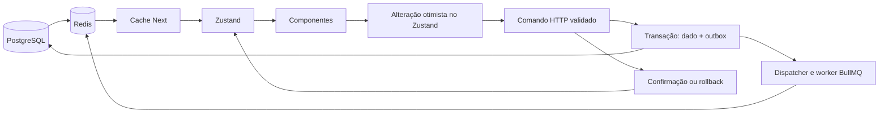

# Jobs, caches e estado otimista

## Fluxo de dados



PostgreSQL continua sendo a fonte de verdade. Leituras consultam revisões de metadados no banco antes de escolher a chave dos caches. O payload segue Redis, cache Next, store Zustand e os componentes, pelos adaptadores existentes ou pelo hook `useDataQuery`. Cache hits podem poupar a leitura do payload; a consulta de revisão impede que uma réplica/worker faça o Next servir uma versão antiga depois de uma gravação.

`readDomain` usa cache Redis versionado com TTL de 300 segundos. Projeções HTTP têm TTL Redis/Next de 30 segundos e chave por sessão, recurso e revisão. Falhas de cache permitem consultar PostgreSQL; dados ausentes ainda verificam a importação Redis legada. O worker publica somente versões iguais ou mais novas. O cache Next usa `unstable_cache`, suportado pelo runtime instalado; o worker não chama APIs de invalidação de outro processo Next.

Metadados estáticos do build e operações nativas de hardware não inventam uma fonte SQL. Provedores, execução de IA, WhatsApp e o simulador local continuam mock/nativos; este worker executa o job real `cache.refresh`. Novos efeitos exigem um tipo/handler validado, sem comandos arbitrários na fila.

## Fila e recuperação

Cada atualização de domínio grava o novo payload e um `BackgroundJob` na mesma transação Prisma. Se uma parte falhar, ambas voltam. O dispatcher lê a outbox persistente e publica no BullMQ. Uma queda entre commit e publicação não perde o trabalho: a linha permanece disponível.

A fila usa IDs determinísticos por job e geração, lease SQL de dispatch de 60 segundos, tokens de execução e publicação de cache idempotente. Dispatcher verifica entregas antigas: se o Redis perdeu uma entrega, a outbox permite republicá-la. Jobs fechados ou de geração anterior não executam novamente. A entrega é at-least-once; não há promessa de exactly-once para futuros efeitos externos.

- Concorrência padrão: 4, configurável por JOHNBOT_WORKER_CONCURRENCY (1–32).
- Limite local por worker: 20 jobs/segundo. Aumentar réplicas também aumenta esse limite total.
- Tentativas: até 5 por geração, com contador persistente no PostgreSQL. BullMQ usa backoff exponencial a partir de 1 segundo.
- Jobs stalled têm recuperação BullMQ limitada; erros finais ficam FAILED para inspeção/retry.
- Redis usa AOF e noeviction; caches e filas têm prefixes separados.
- Jobs concluídos/cancelados permanecem 7 dias no SQL; falhas permanecem disponíveis para ação manual. No Redis, concluídos ficam até 1 dia/1000 entradas e falhas até 7 dias/1000 entradas.

O processo atende SIGTERM/SIGINT, para de despachar e aguarda os jobs ativos. O Compose oferece 30 segundos para encerrar. O healthcheck depende de um heartbeat recente após acesso aos bancos. Worker e migrações usam imagem sem o build do Next; apenas web compila o frontend.

O subset de dependências fica em `infra/worker/package.json` e tem lock próprio. `test-worker-deps.ts` verifica as versões contra o pacote principal. A imagem do worker instala esse subset em modo produção; o cache de instalação Bun fica fora da imagem. Builds do Next usam dois processos para dividir o host com os bancos e workers.

## Controle por sessão

`GET /api/jobs?status=FAILED&limit=50` retorna jobs e contagens de todos os estados, sem payloads de conversa nem IDs de sessão. Limite máximo: 100. A API mantém o pipeline de cache com versão dos estados dos jobs.

`POST /api/commands/jobs.retry`, payload `{ "id": "uuid" }`, aceita apenas FAILED do próprio escopo, incrementa geração e zera tentativas. `jobs.cancel` aceita apenas PENDING/ENQUEUED do próprio escopo. Ambos exigem Idempotency-Key. Rodar ou cancelar todos os jobs de outros usuários não é exposto. Isto entrega API de controle, sem adicionar uma nova tela ao produto.

Consumidores acompanham mudanças de status repetindo o GET/poll. Não há push de estado entre clientes nesta entrega.

## Optimistic first

O cliente HTTP publica leituras validadas na store Zustand. Mutações suportadas instalam camadas otimistas antes de aguardar a rede, serializam os comandos por escopo e reconciliam a resposta confirmada. Preferências e aparência notificam o runtime original pela store, preservando os componentes atuais e restaurando o valor confirmado em falhas. Workflows usam IDs estáveis fornecidos pelo cliente na criação.

Uma falha antiga não apaga uma edição nova. Se todas as alterações falham, a store restaura a base confirmada, não um valor otimista já rejeitado. GETs atrasados não sobrescrevem mutações; logout limpa a store e bloqueia respostas da sessão anterior. Conflitos de grafo também desfazem a camada otimista. A verificação de login continua dependendo da resposta do servidor, sem simular autenticação bem-sucedida.

Comandos retornam após commit SQL, não após todos os efeitos assíncronos. Confirmação invalida consultas; a próxima leitura percorre os caches com a nova revisão. A entrega nativa de mensagens continua no runtime original: um erro de espelhamento não significa que uma execução local possa ser desfeita.

## Operação e testes

```sh
docker compose up -d --build --wait
docker compose ps
docker compose logs --tail 50 worker
bun run worker
```

Para rodar o worker no host, configure DATABASE_URL/REDIS_URL e aplique `bun run db:migrate`. Os bancos do Compose normal continuam internos; `compose.dev.yaml` publica somente em loopback para testes no host. Não limpe volumes para atualizar.

`test:jobs` usa fila e sessão isoladas contra PostgreSQL/Redis reais. Verifica rollback da outbox, dispatch concorrente, cache monotônico, falhas/retries, recuperação de entrega perdida, substituição do worker, cancelamento e isolamento. `test:data-store`, `test-optimistic-client.ts` e `test-runtime-settings.ts` cobrem concorrência/rollback no cliente e atualização dos componentes existentes pelos eventos nativos. `test:domains` inclui a API de jobs. A CI executa essas verificações antes do build.

Referências: [BullMQ connections](https://docs.bullmq.io/guide/connections), [retries](https://docs.bullmq.io/guide/retrying-failing-jobs) e [shutdown](https://docs.bullmq.io/guide/workers/graceful-shutdown).

## Resultado da validação local — 2026-11-12

As imagens web, migrations e worker foram construídas e o Compose terminou com web, worker, PostgreSQL e Redis saudáveis. Jobs produzidos pelos comandos HTTP foram consumidos pelo container e terminaram SUCCEEDED. As cinco suítes HTTP, os testes de fila/concorrência/store/rollback, estilos e navegação em StrictMode passaram. Interromper e reiniciar cada banco preservou os dados confirmados e o worker recuperou sua operação. A validação de navegação usa DOM simulado, sem navegador ou controle da interface do computador.

A CI foi atualizada, mas sua execução remota depende do push. O typecheck integral conserva as pendências legadas do projeto; o build continua com ignoreBuildErrors. O teste local não representa execução de provedores reais de IA ou mensageria.
